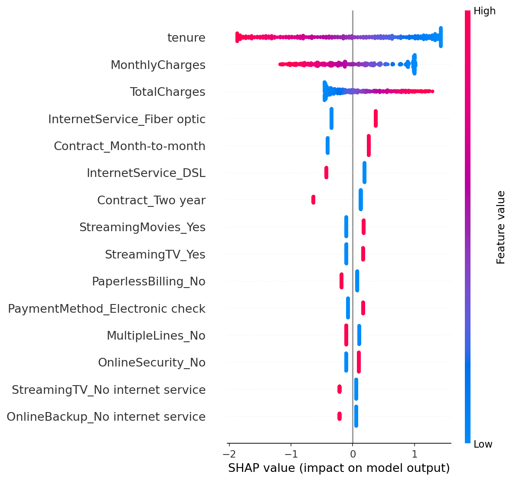

# Customer Churn Prediction and Retention Analytics (Telecom)

An end-to-end machine learning project that predicts which telecom customers are likely to churn, explains why, and serves predictions through a Streamlit app so a retention team can act on them.

**Tech stack:** Python, Scikit-learn, XGBoost, imbalanced-learn (SMOTE), SHAP, MLflow, Streamlit

## Problem

Winning a new customer costs far more than keeping an existing one. The goal is to flag high-risk customers early so the retention team can target them with offers, and to understand which factors drive churn.

## Dataset

[IBM Telco Customer Churn](https://www.kaggle.com/datasets/blastchar/telco-customer-churn): 7,043 customers, 19 features (demographics, services, contract and billing), with a churn rate of about 26.5%.

## Approach

1. **Cleaning:** convert `TotalCharges` to numeric (blank for brand-new customers), drop `customerID`, encode the target.
2. **Preprocessing:** a `ColumnTransformer` (StandardScaler for numeric, OneHotEncoder for categorical) inside a single Pipeline, so training and serving apply identical transformations.
3. **Class imbalance:** compared *class weights* and *SMOTE*.
4. **Model comparison:** Logistic Regression, Random Forest and XGBoost, each with both imbalance strategies (6 candidates), evaluated with stratified 5-fold cross-validation on ROC-AUC, PR-AUC, recall, precision and F1.
5. **Threshold selection:** the decision threshold (max F1) is chosen on out-of-fold training predictions, so the test set is never used to tune it.
6. **Explainability:** SHAP is used to identify the main churn drivers.
7. **Experiment tracking:** every candidate and the final model are logged to MLflow.
8. **Deployment:** a Streamlit app for single-customer and batch scoring.

## Results

Best model: **Logistic Regression with class weights** (decision threshold 0.576).

**5-fold stratified cross-validation (training data)**

| Model | ROC-AUC | PR-AUC | Recall | Precision | F1 |
|---|---|---|---|---|---|
| Logistic Regression (class weights) | 0.846 | 0.660 | 0.801 | 0.517 | 0.628 |
| Logistic Regression (SMOTE) | 0.845 | 0.657 | 0.788 | 0.526 | 0.631 |
| XGBoost (class weights) | 0.844 | 0.664 | 0.769 | 0.532 | 0.629 |
| XGBoost (SMOTE) | 0.843 | 0.659 | 0.621 | 0.614 | 0.617 |
| Random Forest (class weights) | 0.841 | 0.646 | 0.686 | 0.575 | 0.625 |
| Random Forest (SMOTE) | 0.837 | 0.629 | 0.646 | 0.590 | 0.617 |

**Held-out test set (1,409 customers)**

| Metric (churn class) | Value |
|---|---|
| ROC-AUC | 0.842 |
| PR-AUC | 0.633 |
| Recall | 0.72 |
| Precision | 0.54 |
| F1 | 0.62 |

Confusion matrix at the chosen threshold: 271 of 374 churners were caught (232 false alarms among 1,035 customers who stayed).

Test ROC-AUC (0.842) is very close to the cross-validation score (0.846), so the model generalises well and is not overfitting.

## Key churn drivers (SHAP)

The most influential features are **tenure**, **monthly charges**, **total charges**, **fiber-optic internet service** and **month-to-month contracts**. See the SHAP summary plot for the direction of each effect.




## Streamlit app

- **Single customer:** enter customer details and get a churn probability, a risk category (low / medium / high) and suggested retention actions.
- **Batch scoring:** upload a CSV, get predictions for every customer, and download the results.
- **Model insights:** SHAP plots and the model comparison table.

## Project structure

```
.
├── data/                      # place the Kaggle CSV here
├── models/                    # created by train.py (model, metadata, SHAP plots, CV results)
├── train.py                   # training, evaluation, SHAP and MLflow logging
├── app.py                     # Streamlit app
├── requirements.txt
└── README.md
```

## How to run

```bash
pip install -r requirements.txt

# 1. Download the dataset from Kaggle and place the CSV in data/
#    data/WA_Fn-UseC_-Telco-Customer-Churn.csv

# 2. Train, compare models, log to MLflow and save the best pipeline
python train.py --data data/WA_Fn-UseC_-Telco-Customer-Churn.csv

# 3. (Optional) browse MLflow experiments
mlflow ui

# 4. Launch the app
streamlit run app.py
```

## Possible improvements

- Hyperparameter tuning (e.g. GridSearchCV or Optuna) for the tree-based models.
- Threshold selection based on retention-campaign cost and benefit rather than F1.
- Probability calibration and monitoring for data drift after deployment.