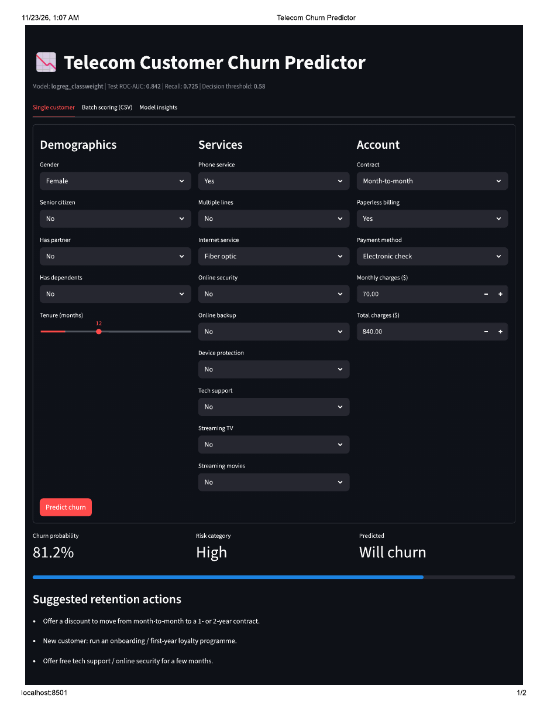
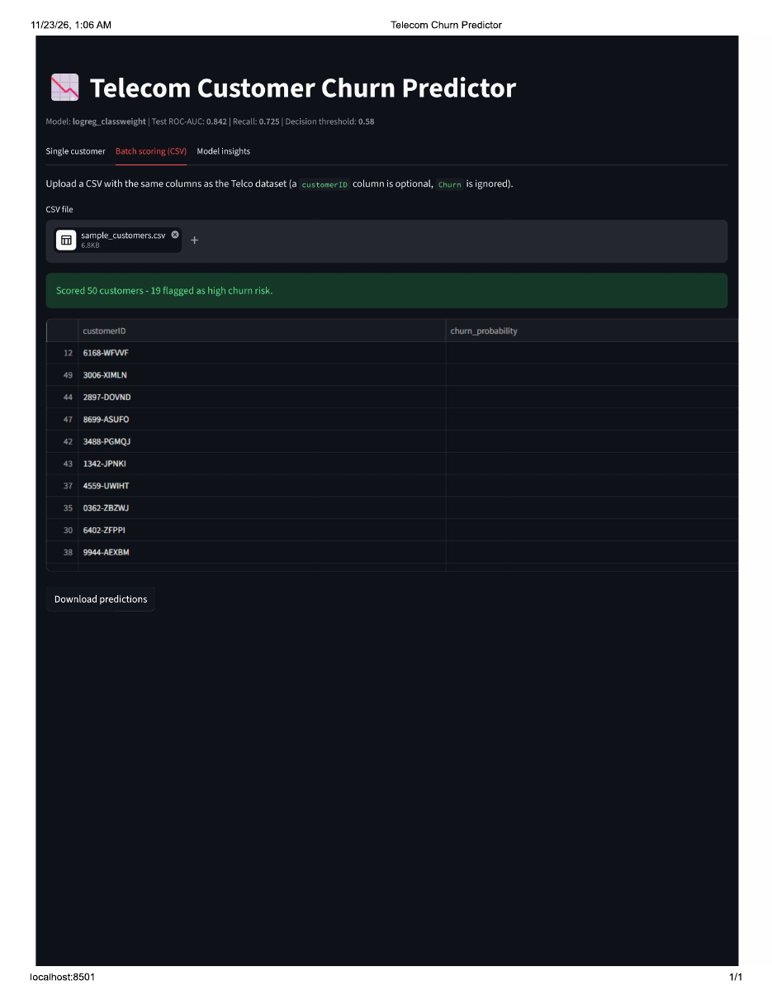
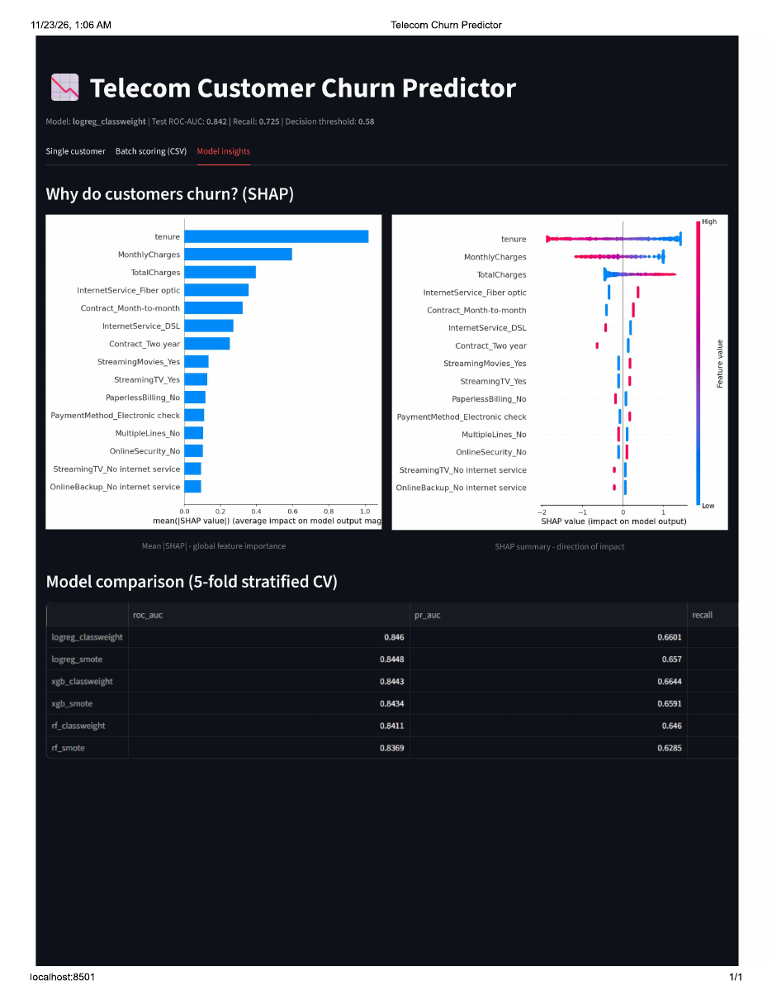
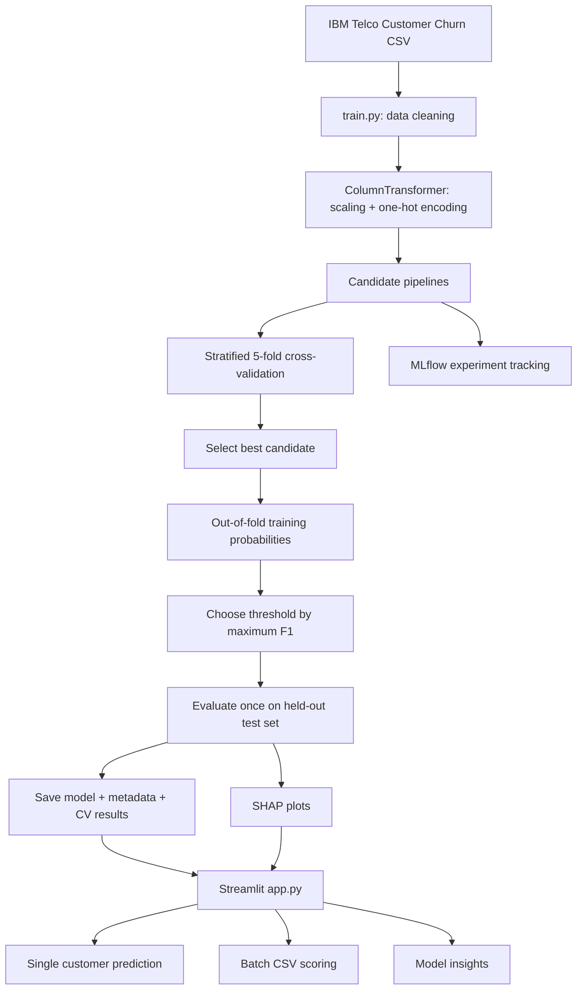

# Telecom Customer Churn Prediction & Retention Analytics

<p align="center">
  <strong>An end-to-end machine learning application to estimate telecom customer churn risk, explain model predictions, and support retention decisions.</strong>
</p>

<p align="center">
  
  
  
  
  
</p>

## Project overview

Customer churn occurs when a customer stops using a company's service. Identifying customers who may leave can help a telecom retention team prioritise outreach and consider relevant retention actions.

This project builds a classification workflow using the IBM Telco Customer Churn dataset. It compares multiple models and class-imbalance strategies, selects a decision threshold using out-of-fold training predictions, explains model behaviour with SHAP, and serves predictions through a Streamlit dashboard.

**Selected model:** Logistic Regression with class weights (`logreg_classweight`)  
**Decision threshold:** `0.5757` (approximately `0.576`)

> This is a portfolio and decision-support project. Predictions are estimates, not guarantees that a customer will or will not churn. Retention suggestions in the app are rule-based examples, not automated business decisions.

## Key features

- Data cleaning and preprocessing for numeric and categorical columns.
- Comparison of Logistic Regression, Random Forest, and XGBoost.
- Comparison of class weighting and SMOTE for class imbalance (six candidate pipelines).
- Stratified 5-fold cross-validation with ROC-AUC, PR-AUC, recall, precision, and F1.
- Decision-threshold selection from out-of-fold predictions on the training split.
- Held-out test evaluation.
- SHAP global feature-importance and summary visualisations.
- MLflow experiment and model tracking.
- Streamlit interface for single-customer prediction, CSV batch scoring, and model insights.
- Downloadable batch prediction results.

## Model performance

### Held-out test set

The metrics below are read from the project's `models/metadata.json`. The held-out test set contains 1,409 customers.

| Metric | Test score |
|---|---:|
| ROC-AUC | **0.8415** |
| PR-AUC | **0.6325** |
| Recall | **0.7246** |
| Precision | **0.5388** |
| F1-score | **0.6180** |
| Decision threshold | **0.5757** |

At the selected threshold, the project README's recorded confusion-matrix summary is: **271 of 374 churners were detected**, with **232 false positives** among customers who did not churn.

### 5-fold stratified cross-validation

The following values are from the repository's `models/cv_results.csv` / training results.

| Candidate | ROC-AUC | PR-AUC | Recall | Precision | F1 |
|---|---:|---:|---:|---:|---:|
| Logistic Regression (class weights) | 0.846 | 0.660 | 0.801 | 0.517 | 0.628 |
| Logistic Regression (SMOTE) | 0.845 | 0.657 | 0.788 | 0.526 | 0.631 |
| XGBoost (class weights) | 0.844 | 0.664 | 0.769 | 0.532 | 0.629 |
| XGBoost (SMOTE) | 0.843 | 0.659 | 0.621 | 0.614 | 0.617 |
| Random Forest (class weights) | 0.841 | 0.646 | 0.686 | 0.575 | 0.625 |
| Random Forest (SMOTE) | 0.837 | 0.629 | 0.646 | 0.590 | 0.617 |

**Why Logistic Regression with class weights?** It achieved the highest cross-validation ROC-AUC among the six candidates (0.846), and its held-out test ROC-AUC is 0.8415. The model choice is based on the recorded experiment results, not on a claim that Logistic Regression is universally best.

## Application screenshots

### Single-customer prediction

The app accepts customer attributes and displays estimated churn probability, risk band, threshold-based prediction, and rule-based retention suggestions.



### Batch scoring

The batch tab accepts a CSV with the Telco dataset columns. `customerID` is optional and `Churn` is ignored; the app scores the rows and offers a downloadable predictions CSV.



### Model insights

The insights tab displays SHAP visualisations and the cross-validation model comparison.



## Explainability: important churn drivers

The saved SHAP global-importance results highlight these influential features:

1. `tenure`
2. `MonthlyCharges`
3. `TotalCharges`
4. `InternetService_Fiber optic`
5. `Contract_Month-to-month`

The SHAP plots below are generated and stored by the training workflow. They describe model associations and should not be interpreted as proof of causation.

<p align="center">
  
  
</p>

## Workflow and architecture



### Training and serving design

- `train.py` performs preprocessing, candidate model evaluation, threshold selection, test evaluation, SHAP generation, artifact saving, and MLflow logging.
- The preprocessing transformer is kept inside the model pipeline so the same transformations are applied during training and inference.
- `app.py` loads the saved model and metadata from `models/` and exposes the three dashboard tabs.

## Dataset

- **Dataset:** IBM Telco Customer Churn.
- **Rows:** 7,043 customer records.
- **Predictor fields:** 19 input features used by the model.
- **Target:** `Churn`.
- **Source:** [Telco Customer Churn dataset on Kaggle](https://www.kaggle.com/datasets/blastchar/telco-customer-churn).

The training script converts `TotalCharges` to numeric, handles blank values, removes `customerID` from model features, and encodes the churn target. Numeric features are standardised and categorical features are one-hot encoded through a `ColumnTransformer` in a pipeline.

## Repository structure

```text
churn_project/
├── app.py
├── train.py
├── requirements.txt
├── README.md
├── data/
│   └── .gitkeep
├── models/
│   ├── churn_model.joblib
│   ├── metadata.json
│   ├── cv_results.csv
│   ├── shap_importance.png
│   └── shap_summary.png
├── outputs/
│   ├── batch_scoring.pdf
│   ├── churn_predictions.csv
│   ├── model_insights.pdf
│   └── single_customer_prediction.pdf
└── screenshots/
    ├── batch-scoring.png
    ├── model-insights.png
    └── single-customer-prediction.png
```

`mlruns/` and `mlflow.db` are local MLflow tracking artifacts and are not required to launch the Streamlit application. The dataset itself is not included in this repository's `data/` directory; download it from the source linked above.

## Run locally

### 1. Clone the repository

```bash
git clone https://github.com/satyanandpandey71-byte/telco-churn-prediction.git
cd telco-churn-prediction
```

### 2. Create and activate a virtual environment

**Windows PowerShell**

```powershell
python -m venv .venv
.\.venv\Scripts\Activate.ps1
```

**macOS / Linux**

```bash
python -m venv .venv
source .venv/bin/activate
```

### 3. Install dependencies

```bash
python -m pip install --upgrade pip
pip install -r requirements.txt
```

### 4. Download the dataset

Download the [IBM Telco Customer Churn CSV](https://www.kaggle.com/datasets/blastchar/telco-customer-churn) and place it at:

```text
data/WA_Fn-UseC_-Telco-Customer-Churn.csv
```

### 5. Train the model

```bash
python train.py --data data/WA_Fn-UseC_-Telco-Customer-Churn.csv
```

This runs the model comparison and evaluation workflow and saves the model artefacts under `models/`. It also logs experiments to MLflow.

### 6. Launch the Streamlit application

```bash
streamlit run app.py
```

Open the local URL printed by Streamlit in your browser.

### 7. (Optional) View MLflow experiments

In a separate terminal, from the project directory:

```bash
mlflow ui
```

Then open the local MLflow UI URL printed in the terminal.

## Batch CSV input

The batch-scoring tab expects the same predictor columns as the Telco dataset. The `customerID` column is optional; `Churn` is ignored. The app returns:

- `customerID`
- `churn_probability`
- `risk`
- `predicted_churn`

A sample input file is available as `sample_customers.csv`.

## Limitations and responsible use

- The model is trained and evaluated on the IBM Telco Customer Churn dataset; performance may differ on other telecom providers, populations, or time periods.
- A probability score is not a certainty. Threshold choice changes the balance between missed churners and false alerts.
- The current threshold is selected to maximise F1 on out-of-fold training predictions. A real retention programme should select a threshold using campaign costs, customer lifetime value, and intervention effectiveness.
- The app's risk bands (Low / Medium / High) and retention tips are rule-based application logic; they are not separate trained models or causal recommendations.
- No SQL analytics module or public cloud deployment is included in the inspected project version.
- Before using customer-level data in a public repository or external service, remove or anonymise personal and confidential information.

## Current outputs

Detailed generated reports and predictions are available in [`outputs/`](outputs/):

- [Model insights report](outputs/model_insights.pdf)
- [Batch scoring report](outputs/batch_scoring.pdf)
- [Single-customer prediction report](outputs/single_customer_prediction.pdf)
- [Batch prediction results](outputs/churn_predictions.csv)

## Future improvements

- Add SQL-based churn and revenue analysis.
- Deploy the Streamlit app and document the public demo URL.
- Tune hyperparameters for tree-based models and compare results on a consistent validation protocol.
- Evaluate probability calibration and monitor data drift after deployment.
- Select an operational decision threshold using retention-campaign economics rather than F1 alone.

## Author

**Satyanand Pandey**  
[GitHub Profile](https://github.com/satyanandpandey71-byte) · [Project Repository](https://github.com/satyanandpandey71-byte/telco-churn-prediction)
