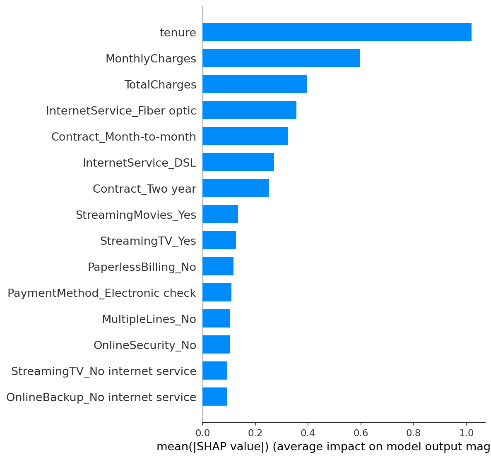

# Customer Churn Prediction and Retention Analytics (Telecom)

End-to-end churn project on the IBM Telco Customer Churn dataset: model comparison, imbalance handling, SHAP explainability, MLflow experiment tracking and a Streamlit app.

**Tech:** Python, Scikit-learn, XGBoost, imbalanced-learn (SMOTE), SHAP, MLflow, Streamlit

## Problem
Acquiring a new customer costs far more than keeping one. The goal is to predict which customers are likely to churn so the retention team can target them with offers.

## Approach
1. **Cleaning** - fix `TotalCharges` (blank for new customers), drop `customerID`, encode target.
2. **Preprocessing** - `ColumnTransformer` (StandardScaler + OneHotEncoder) inside a single Pipeline, so training and serving are identical.
3. **Class imbalance** (~26% churn) - compared *class weights* vs *SMOTE*.
4. **Models** - Logistic Regression, Random Forest, XGBoost, each with both strategies (6 candidates), evaluated with stratified 5-fold CV on ROC-AUC, PR-AUC, recall, precision, F1.
5. **Threshold** - chosen from out-of-fold predictions (max F1) to avoid test leakage.
6. **Explainability** - SHAP identifies the main drivers (contract type, tenure, monthly charges, etc.).
7. **Tracking** - every candidate logged to MLflow; the final model + artifacts logged too.
8. **Deployment** - Streamlit app: single-customer prediction, batch CSV scoring, retention suggestions, model insights.

## Project structure
```
.
├── data/WA_Fn-UseC_-Telco-Customer-Churn.csv   # download from Kaggle (IBM Telco)
├── train.py
├── app.py
├── requirements.txt
└── models/                                     # created by train.py
```

## How to run
```bash
pip install -r requirements.txt

# 1. Put the dataset in data/ (Kaggle: "Telco Customer Churn" by IBM / blastchar)
# 2. Train, compare models, log to MLflow, save the best pipeline
python train.py --data data/WA_Fn-UseC_-Telco-Customer-Churn.csv

# 3. Browse experiments
mlflow ui

# 4. Launch the app
streamlit run app.py
```

## Results
Run `python train.py` and fill in your numbers here (see `models/cv_results.csv`):

| Metric (test set) | Value |
|---|---|
| ROC-AUC | _your value_ |
| PR-AUC | _your value_ |
| Recall (churn) | _your value_ |
| Precision (churn) | _your value_ |
## Results

Best model: **Logistic Regression (class weights)**, decision threshold tuned on out-of-fold predictions.

**5-fold stratified CV (training data)**

| Model | ROC-AUC | PR-AUC | Recall | Precision | F1 |
|---|---|---|---|---|---|
| Logistic Regression (class weights) | 0.846 | 0.660 | 0.801 | 0.517 | 0.628 |
| XGBoost (class weights) | 0.844 | 0.664 | 0.769 | 0.532 | 0.629 |
| Random Forest (class weights) | 0.841 | 0.646 | 0.686 | 0.575 | 0.625 |

**Held-out test set (1,409 customers)**

| Metric (churn class) | Value |
|---|---|
| ROC-AUC | _see models/metadata.json_ |
| Recall | 0.72 |
| Precision | 0.54 |
| F1 | 0.62 |

Top churn drivers (SHAP): tenure, monthly charges, fiber-optic internet, month-to-month contract.

